# ALL-E: Assistant for Lifelong Learning, intelligent and Empathic

ALL-E is a Moodle block that gives each course an AI assistant. Learners ask
questions at any time and get answers drawn from the documents their teacher
selected, with the sources cited. Teachers choose those documents and adjust
the prompt that frames every answer.

ALL-E was developed by Université TÉLUQ (Canada) and Université Gaston Berger
de Saint-Louis (Senegal), with the support of the Agence universitaire de la
Francophonie (AUF).

<table>
  <tr>
    <td width="50%">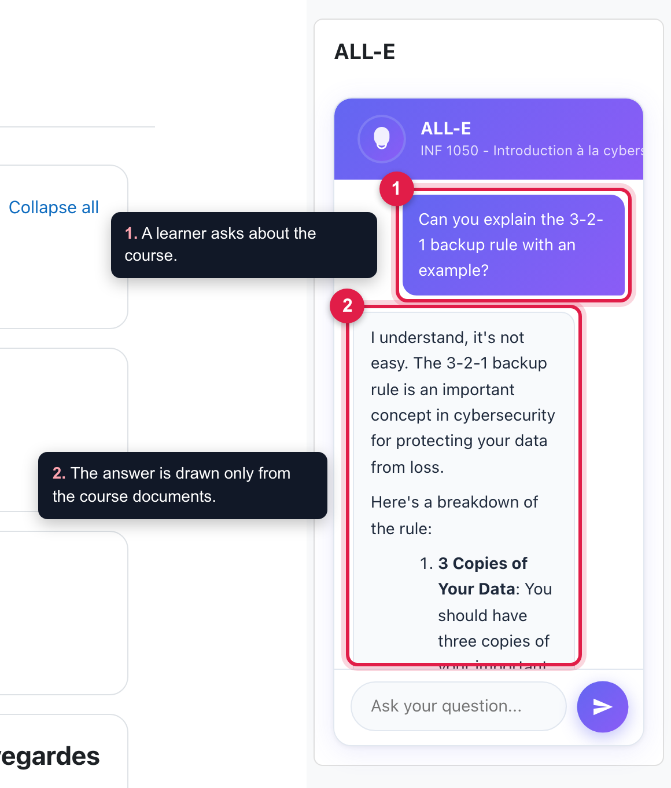</td>
    <td width="50%">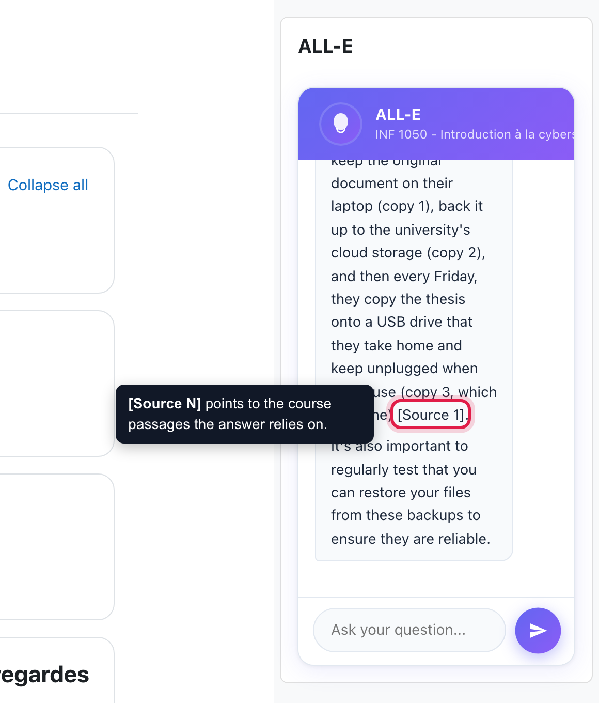</td>
  </tr>
  <tr>
    <td><b>Answers from the course.</b> A learner asks a question in the block; ALL-E answers from the documents the teacher uploaded.</td>
    <td><b>Cited sources.</b> <code>[Source N]</code> points to the course passages the answer relies on.</td>
  </tr>
  <tr>
    <td>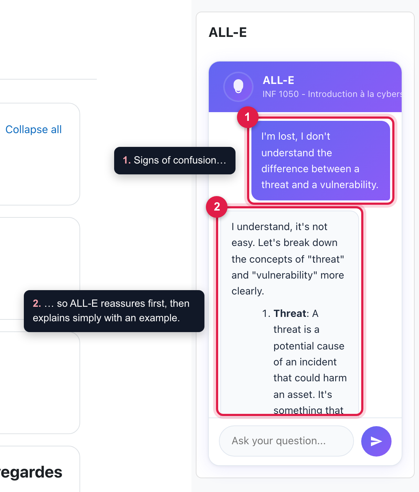</td>
    <td>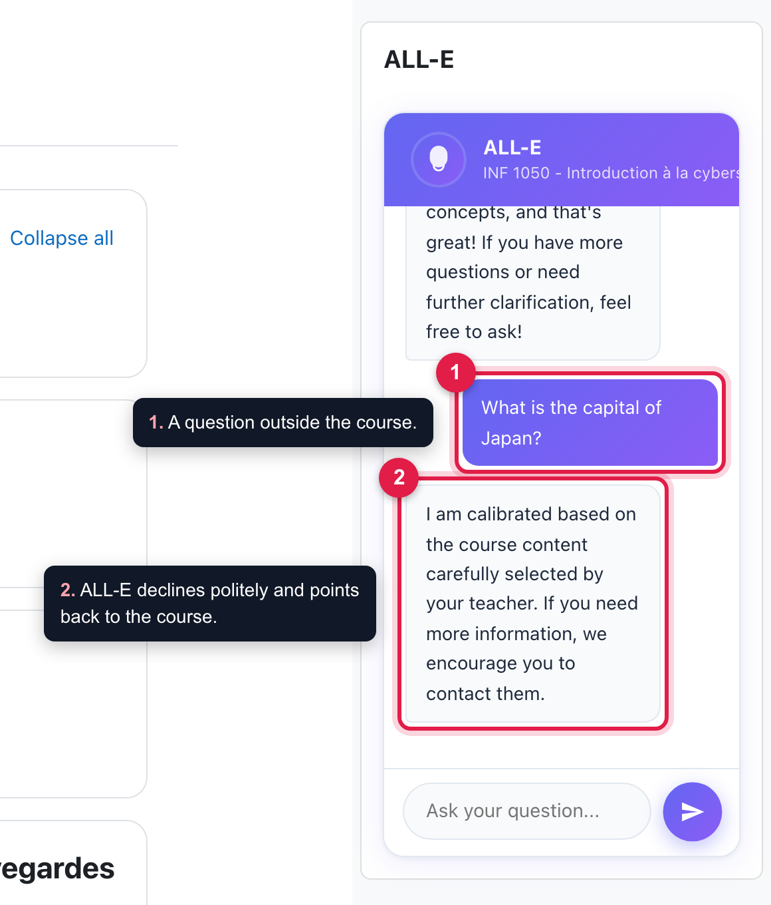</td>
  </tr>
  <tr>
    <td><b>Empathy.</b> When a learner sounds lost, ALL-E reassures first, then explains simply.</td>
    <td><b>Stays on topic.</b> Questions outside the course are declined politely.</td>
  </tr>
</table>

## How it answers

When a teacher uploads course documents, ALL-E extracts their text, splits it
into overlapping passages of about 1,500 characters and stores the passages,
with their embeddings, in a Weaviate collection dedicated to the course.

Two answering modes are available:

- **Standard RAG** searches the course once and answers from the ten closest
  passages.
- **Agentic RAG** (default) checks whether the passages it found are close
  enough to the question. When they are not, it rewrites the question with the
  vocabulary of the course and searches again, at most twice. It then asks the
  language model to rank the passages and answers from the six best ones,
  citing them as `[Source N]`.

The default prompt asks the assistant to stay within the course, to recognise
signs of confusion, frustration, stress or doubt, and to answer with empathy.
The assistant remembers the last ten exchanges of each learner in each course.

## Requirements

- Moodle 4.5 or later.
- An AI provider for generation and embeddings, either:
  - [OpenRouter](https://openrouter.ai), which gives access to many hosted
    models, or
  - [Hugging Face](https://huggingface.co), or your own server exposing the
    same API, which keeps course content inside your network.
- A [Weaviate](https://weaviate.io) vector database, self-hosted or on
  Weaviate Cloud.
- To read PDFs: `pdftotext` from poppler-utils on the server, and optionally
  [Adobe PDF Services](https://developer.adobe.com/document-services/apis/pdf-services)
  for scanned documents.

## Installation

1. Copy the plugin to `blocks/alle` in your Moodle code (`public/blocks/alle`
   from Moodle 5.1), or install it from the Moodle plugins directory.
2. Visit **Site administration > Notifications** to complete the installation.
3. Fill in the settings under **Site administration > Plugins > Blocks > ALL-E**,
   then use **Check the services** to confirm that every service answers.
4. In a course, turn editing on and add the **ALL-E** block.
5. As a teacher, upload the course documents from the block.

## Configuration

All settings are under **Site administration > Plugins > Blocks > ALL-E**.

### Answering and AI provider

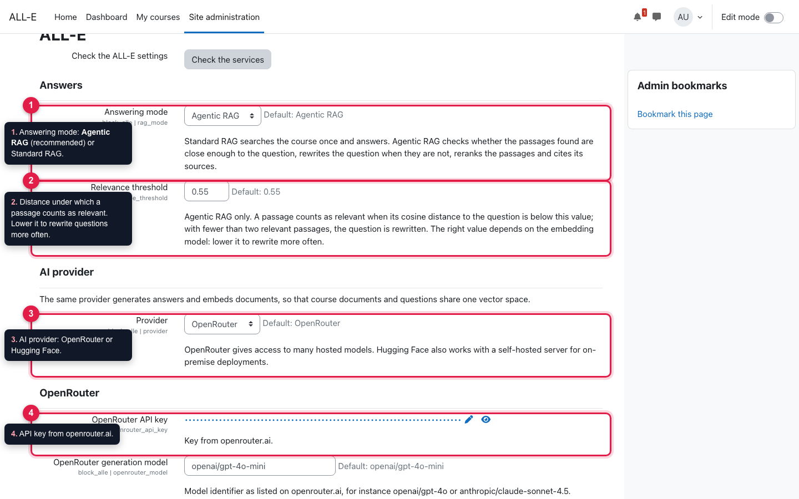

1. **Answering mode**: Agentic RAG (default, recommended) or Standard RAG.
2. **Relevance threshold** (Agentic RAG): cosine distance under which a passage
   counts as relevant (default 0.55). With fewer than two relevant passages the
   question is rewritten. The right value depends on the embedding model; lower
   it to rewrite questions more often.
3. **Provider**: OpenRouter or Hugging Face. The same provider generates the
   answers and embeds the documents, so documents and questions share one
   vector space.
4. **API key** of the provider.

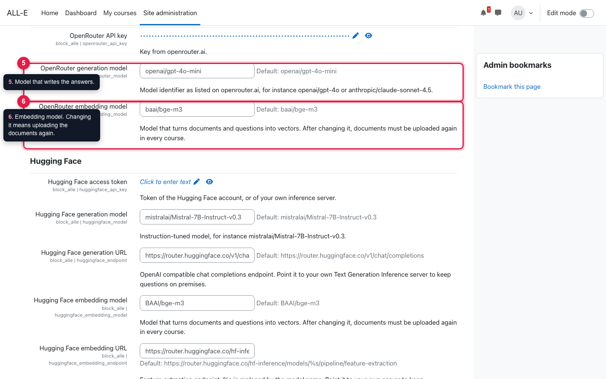

5. **Generation model**, for instance `openai/gpt-4o-mini` or `openai/gpt-4o`.
6. **Embedding model**. BAAI bge-m3 (default) is multilingual. Changing it means
   uploading the documents again in every course.

With Hugging Face, you can also point the generation and embedding endpoints
to your own server, so that course content stays inside your network.

### Vector database and PDF reading

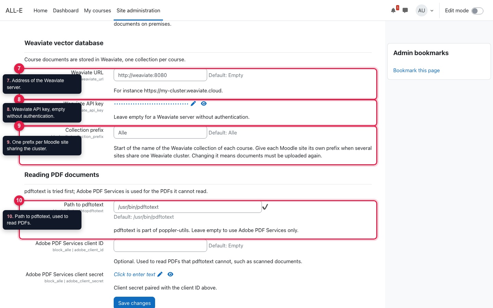

7. **Weaviate URL**, self-hosted or Weaviate Cloud.
8. **Weaviate API key**, empty when the server has no authentication.
9. **Collection prefix** (default `Alle`). Each course gets its own collection,
   such as `Alle_course_42`; give each Moodle site its own prefix when several
   sites share one Weaviate cluster. Changing it means uploading the documents
   again.
10. **Path to pdftotext**, used to read PDFs. Adobe PDF Services credentials,
    further down the page, are optional and only used for PDFs that pdftotext
    cannot read, such as scans.

### Check the services

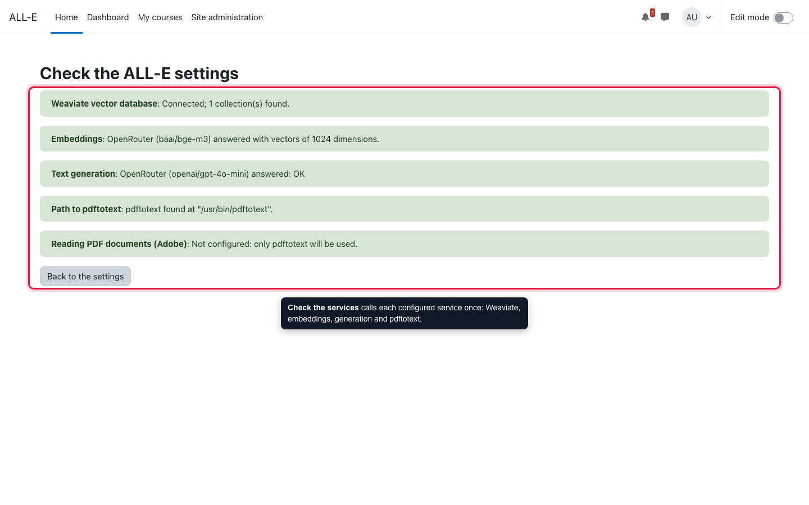

Once the settings are saved, **Check the services** calls each configured
service once and reports what answered. Calls to AI providers may be charged.

### In the course

<table>
  <tr>
    <td width="33%">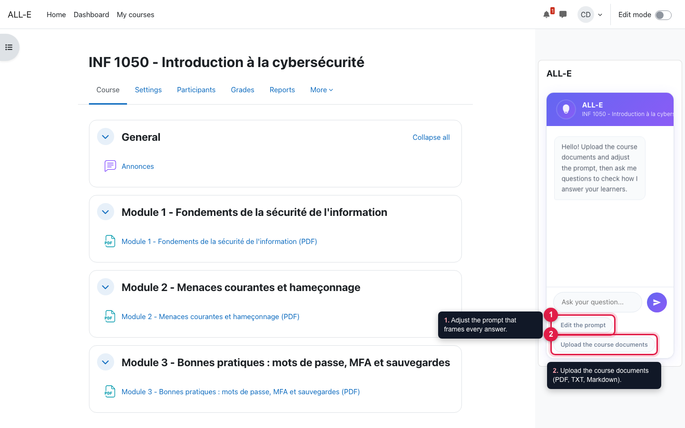</td>
    <td width="33%">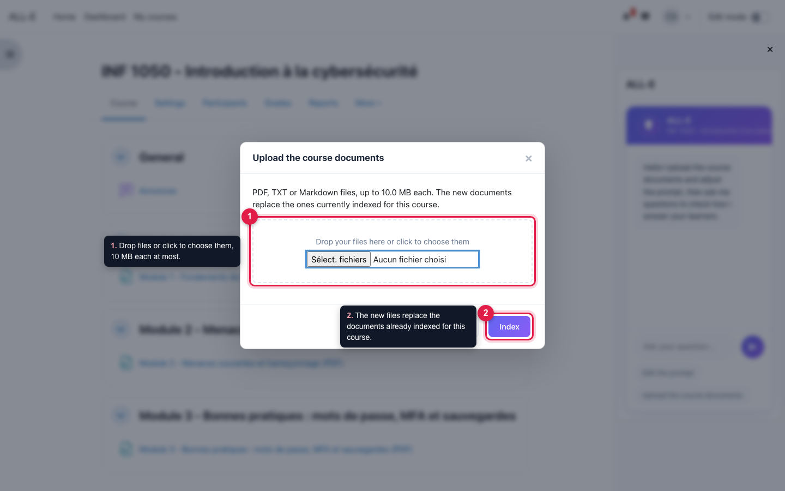</td>
    <td width="33%">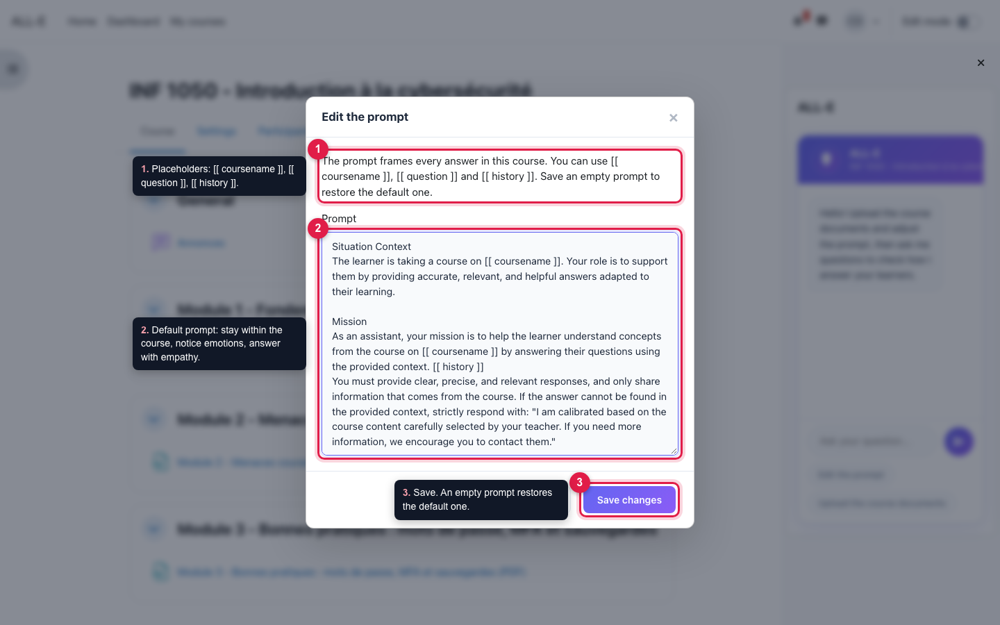</td>
  </tr>
  <tr>
    <td>Teachers see two extra buttons in the block.</td>
    <td><b>Upload the course documents</b>: PDF, TXT or Markdown, 10 MB each at most. New files replace the documents already indexed for the course.</td>
    <td><b>Edit the prompt</b> that frames every answer, with the placeholders <code>[[ coursename ]]</code>, <code>[[ question ]]</code> and <code>[[ history ]]</code>. An empty prompt restores the default one.</td>
  </tr>
</table>

## Capabilities

| Capability | Default roles | Allows |
| --- | --- | --- |
| `block/alle:addinstance` | Editing teacher, manager | Adding the block to a course. |
| `block/alle:ask` | Student, teacher, editing teacher, manager | Chatting with the assistant. |
| `block/alle:managecontent` | Editing teacher, manager | Editing the prompt and replacing the course documents. |

## Privacy

ALL-E stores the last ten questions and answers of each learner in each course,
and the prompt of each course. Questions, the recent conversation and the
prompt are sent to the configured AI provider; course documents are stored in
the configured Weaviate database, and PDFs that pdftotext cannot read are sent
to Adobe PDF Services. The plugin implements the Moodle privacy API for export
and deletion.

## Development

Run the checks of the [Moodle plugin CI](https://moodlehq.github.io/moodle-plugin-ci/):
the code checker, PHPDoc, PHPUnit (`tests/`) and Behat (`tests/behat`). The
JavaScript is built with `grunt amd` from a Moodle checkout. See
[MAINTAIN.md](MAINTAIN.md).

Translations are managed through [AMOS](https://lang.moodle.org) once the
plugin is published; the plugin itself only ships the English strings.

## Research

The architecture and its evaluation are described in: A. Diattara,
M. L. Diakhame, V. Psyché, N. El Mawas, *From Standard RAG to Agentic
Orchestration: An Architecture for Moodle-Based Educational Conversational
Agents*, PA-AI&SS 2026, Springer LNICST.

## License

GNU GPL v3 or later. See [LICENSE](LICENSE).
