# Guide utilisateur d'ALL-E

**ALL-E** (*Assistant for Lifelong Learning, intelligent and Empathic*) est un bloc Moodle qui donne à chaque cours un assistant d'apprentissage. Les étudiants lui posent leurs questions à toute heure ; il répond **uniquement à partir des documents choisis par l'enseignant**, cite ses sources et adapte son ton quand il perçoit de la confusion, du stress ou du découragement.

ALL-E a été développé par l'Université TÉLUQ (Canada) et l'Université Gaston Berger de Saint-Louis (Sénégal), avec le soutien de l'Agence universitaire de la Francophonie (AUF).

Ce guide s'adresse aux trois profils qui utilisent ALL-E :

| Profil | Ce qu'il fait | Section |
| --- | --- | --- |
| Administrateur Moodle | Installe le plugin, le relie au fournisseur d'IA et à Weaviate | [1. Administrateur](#1-administrateur) |
| Enseignant | Ajoute l'assistant au cours, choisit les documents, ajuste la consigne | [2. Enseignant](#2-enseignant) |
| Étudiant | Pose ses questions à l'assistant | [3. Étudiant](#3-étudiant) |

Une **vidéo de démonstration** de 2 minutes accompagne ce guide : `docs/video/demo-ALL-E.mp4`.

> Les captures de ce guide viennent d'un cours fictif, *INF 1050 - Introduction à la cybersécurité*, avec une interface Moodle en français.

---

## Comment ALL-E répond

1. L'enseignant téléverse les documents du cours (PDF, TXT ou Markdown).
2. ALL-E en extrait le texte, le découpe en passages d'environ 1 500 caractères et range ces passages, avec leur représentation vectorielle, dans une collection **Weaviate** propre au cours.
3. Quand un étudiant pose une question, ALL-E cherche les passages les plus proches de la question, puis demande au modèle de langage de rédiger une réponse **à partir de ces seuls passages**.

Deux modes de réponse existent :

- **RAG standard** : une seule recherche, réponse à partir des dix passages les plus proches.
- **RAG agentique** (par défaut) : ALL-E vérifie que les passages trouvés sont assez proches de la question. Sinon, il reformule la question avec le vocabulaire du cours et cherche de nouveau (deux fois au plus). Il classe ensuite les passages et répond à partir des six meilleurs, en les citant sous la forme `[Source N]`.

ALL-E retient les **dix derniers échanges** de chaque étudiant dans chaque cours, pour suivre le fil de la conversation.

---

## 1. Administrateur

### 1.1 Prérequis

- Moodle 4.5 ou plus récent (testé sur Moodle 4.5 LTS et PHP 8.3).
- Un fournisseur d'IA pour la génération et les plongements (*embeddings*) :
  - **OpenRouter** (clé sur [openrouter.ai](https://openrouter.ai)), qui donne accès à de nombreux modèles ;
  - ou **Hugging Face**, ou votre propre serveur compatible, pour garder les contenus chez vous.
- Une base vectorielle **Weaviate** (auto-hébergée ou Weaviate Cloud).
- `pdftotext` (paquet *poppler-utils*) sur le serveur pour lire les PDF ; en option, Adobe PDF Services pour les PDF numérisés.

### 1.2 Installation

1. Copiez le plugin dans `blocks/alle` du code de Moodle (`public/blocks/alle` à partir de Moodle 5.1).
2. Ouvrez **Administration du site > Notifications** pour terminer l'installation.
3. Remplissez les réglages (section suivante), puis vérifiez les services.

> **Weaviate sur un réseau privé ou un port non standard.** Moodle bloque par défaut les appels cURL vers les adresses privées (10.x, 172.16-31.x, 192.168.x, localhost) et vers les ports autres que 80 et 443. Si Weaviate tourne sur le même serveur ou dans un réseau Docker (par exemple `http://weaviate:8080`), adaptez **Administration du site > Général > Sécurité > Sécurité HTTP** : retirez la plage concernée de *cURL hôtes bloqués* et ajoutez le port à *cURL ports autorisés*.

### 1.3 Réglages

Les réglages se trouvent dans **Administration du site > Plugins > Blocs > ALL-E**.

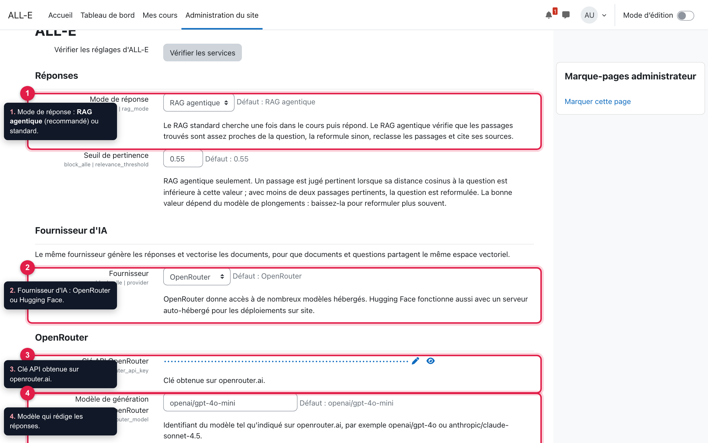

1. **Mode de réponse** : *RAG agentique* (recommandé) ou *RAG standard*. Le *seuil de pertinence* (0,55 par défaut) règle à partir de quand le mode agentique reformule la question ; baissez-le pour qu'il reformule plus souvent.
2. **Fournisseur** : OpenRouter ou Hugging Face. Le même fournisseur sert à rédiger les réponses et à vectoriser les documents.
3. **Clé API OpenRouter**.
4. **Modèle de génération** : par exemple `openai/gpt-4o-mini` (économique) ou `openai/gpt-4o`. Le **modèle de plongements** par défaut, `baai/bge-m3`, est multilingue.

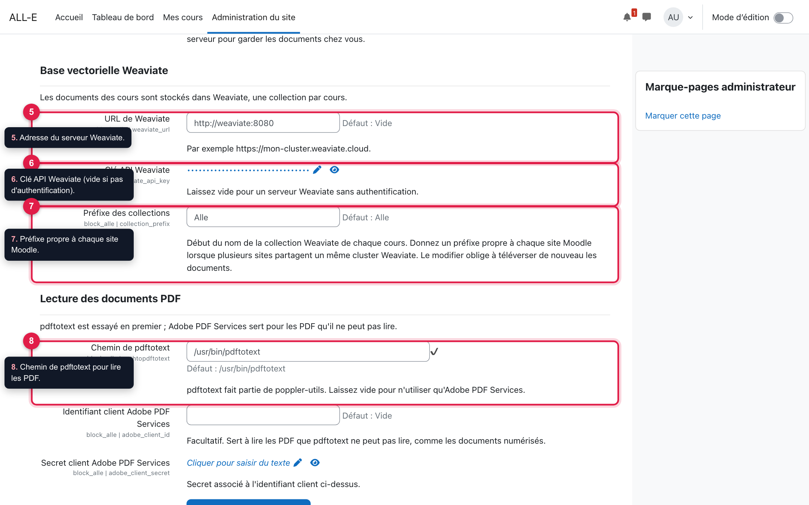

5. **URL de Weaviate**.
6. **Clé API Weaviate**, si votre serveur exige une authentification.
7. **Préfixe des collections** : donnez un préfixe différent à chaque site Moodle qui partage le même Weaviate.
8. **Chemin de pdftotext** : `/usr/bin/pdftotext` sur la plupart des serveurs Linux.

> Changer de modèle de plongements ou de préfixe oblige les enseignants à **téléverser de nouveau** leurs documents.

Cliquez sur **Enregistrer les modifications**.

### 1.4 Vérifier les services

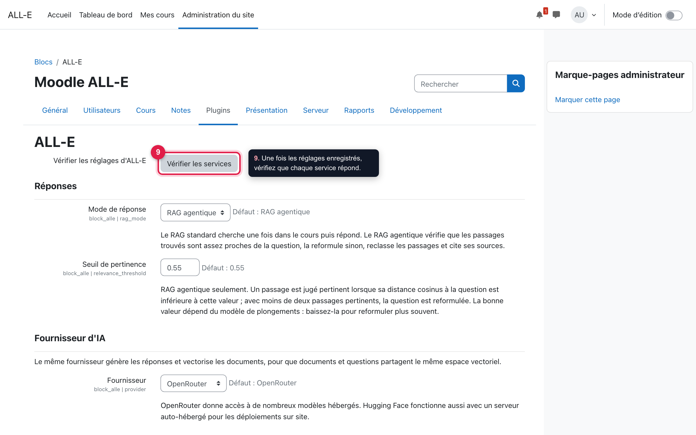

En haut de la page des réglages, le bouton **Vérifier les services** (9) appelle une fois chaque service configuré.

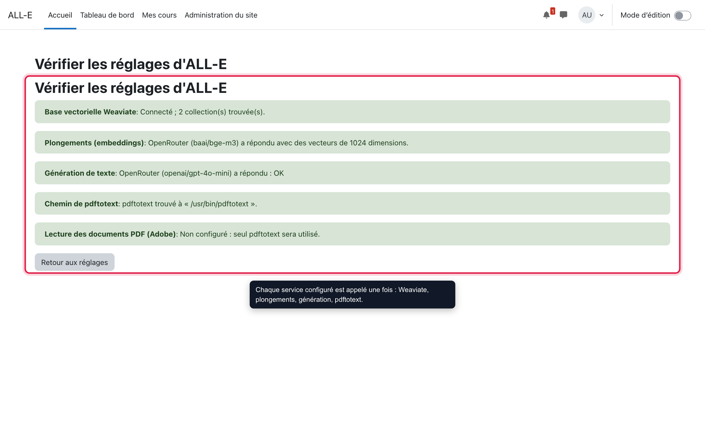

Chaque ligne verte confirme qu'un service répond : Weaviate, plongements (avec la taille des vecteurs), génération de texte, pdftotext. Une ligne rouge donne le message d'erreur du service concerné (voir [Dépannage](#5-dépannage)).

> Les appels aux fournisseurs d'IA peuvent être facturés ; la vérification n'en fait que deux, très courts.

### 1.5 Permissions

| Capacité | Rôles par défaut | Permet |
| --- | --- | --- |
| `block/alle:addinstance` | Enseignant, gestionnaire | Ajouter le bloc à un cours |
| `block/alle:ask` | Étudiant, enseignant non éditeur, enseignant, gestionnaire | Discuter avec l'assistant |
| `block/alle:managecontent` | Enseignant, gestionnaire | Modifier la consigne et remplacer les documents |

---

## 2. Enseignant

### 2.1 Ajouter ALL-E à votre cours

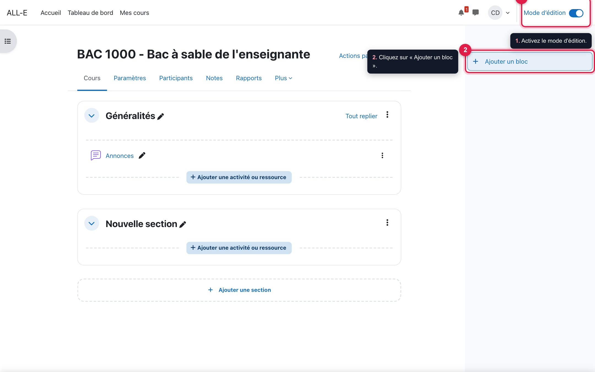

1. Dans votre cours, activez le **Mode d'édition** (en haut à droite).
2. Ouvrez le tiroir des blocs à droite et cliquez sur **Ajouter un bloc**.

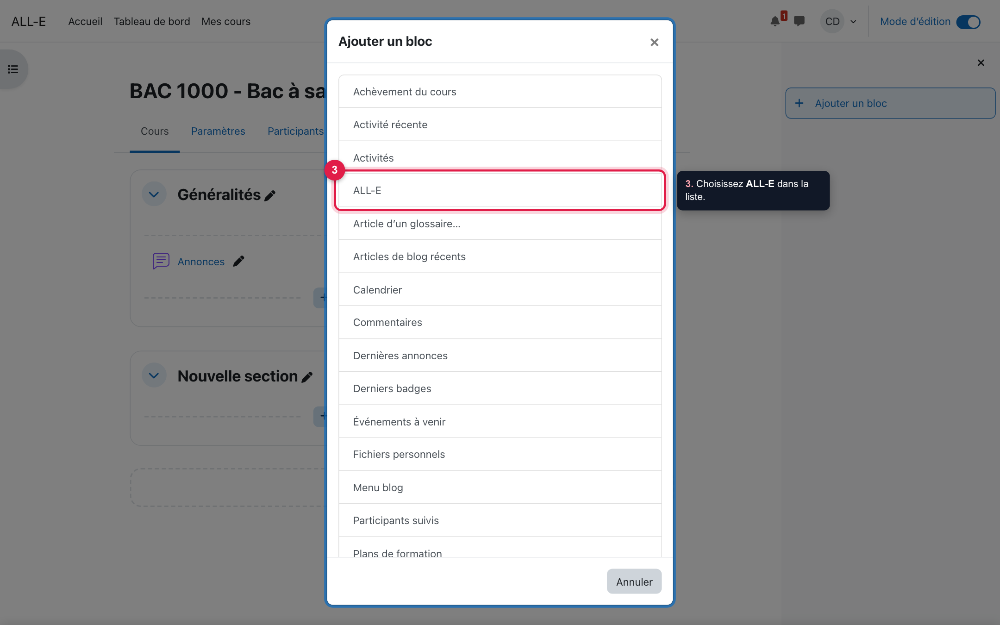

3. Choisissez **ALL-E** dans la liste. Un cours ne peut contenir qu'un seul bloc ALL-E.

Désactivez ensuite le mode d'édition.

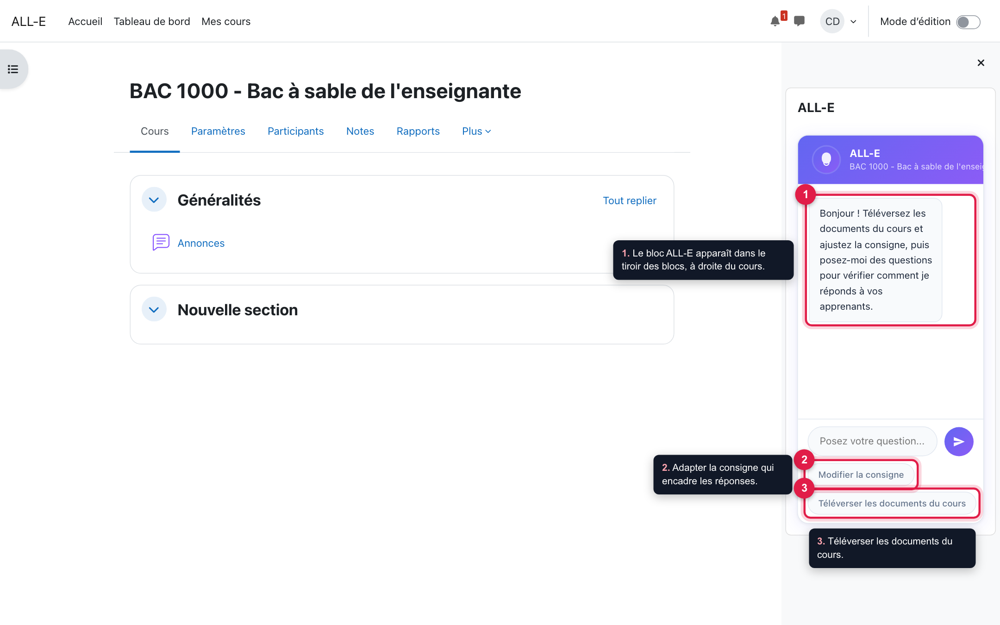

Le bloc apparaît dans le tiroir de droite (1). Comme enseignant, vous voyez deux boutons de plus que vos étudiants :

2. **Modifier la consigne** ;
3. **Téléverser les documents du cours**.

### 2.2 Téléverser les documents du cours

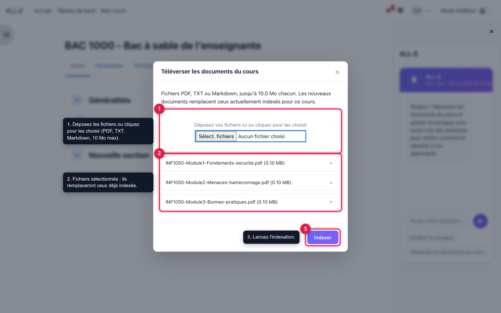

1. Déposez vos fichiers dans la zone, ou cliquez pour les choisir. Formats acceptés : **PDF, TXT, Markdown**, 10 Mo au plus par fichier.
2. Vérifiez la liste ; la croix retire un fichier.
3. Cliquez sur **Indexer**.

> **Important.** Chaque téléversement **remplace** tous les documents déjà indexés pour ce cours. Pour ajouter un document, téléversez de nouveau l'ensemble des documents.

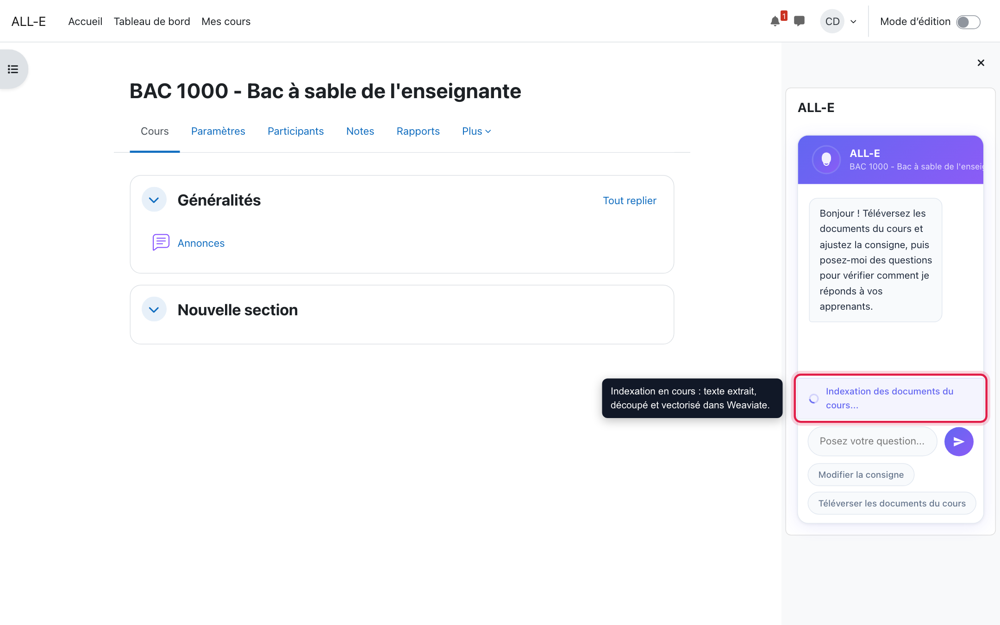

L'indexation prend de quelques secondes à quelques minutes selon le volume. Si un fichier ne peut pas être lu, les documents déjà indexés sont conservés.

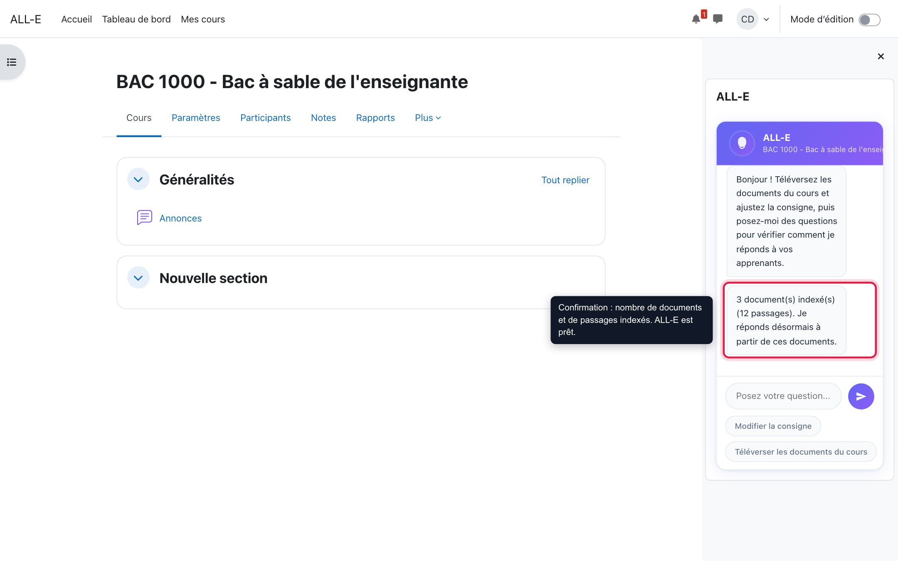

ALL-E confirme le nombre de documents et de passages indexés. Il est prêt à répondre.

**Conseils pour les documents**

- Préférez des PDF « texte » (exportés d'un traitement de texte) aux PDF numérisés, que `pdftotext` ne sait pas lire.
- Des documents bien structurés (titres, définitions, exemples) donnent de meilleures réponses.
- Ne téléversez que ce que vous acceptez de voir cité : ALL-E peut reprendre n'importe quel passage.

### 2.3 Ajuster la consigne (le *prompt*)

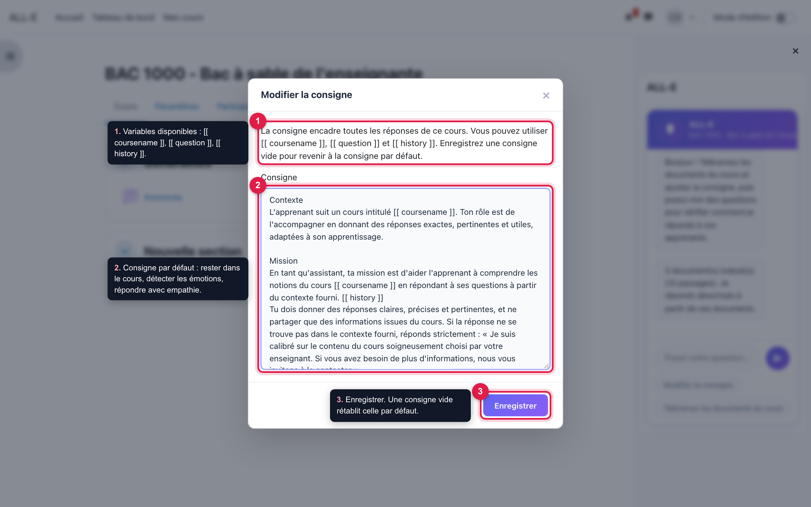

La consigne encadre toutes les réponses de l'assistant dans votre cours.

1. Trois variables sont remplacées automatiquement : `[[ coursename ]]` (nom du cours), `[[ question ]]` (question de l'étudiant) et `[[ history ]]` (échanges précédents).
2. La consigne par défaut demande à ALL-E de rester dans le contenu du cours, de repérer les signes de confusion, de frustration, de stress ou de doute, et d'y répondre avec empathie.
3. **Enregistrer**. Une consigne **vide** rétablit la consigne par défaut.

Exemples d'ajustements utiles :

- « Termine chaque réponse par une question de vérification de la compréhension. »
- « Ne donne jamais directement la réponse aux exercices notés ; guide l'étudiant pas à pas. »
- « Réponds en anglais. »

### 2.4 Tester avant d'ouvrir aux étudiants

Posez vous-même des questions dans le bloc : une question précise du cours, une question vague, une question hors sujet. Ajustez la consigne ou les documents si besoin.

---

## 3. Étudiant

### 3.1 Poser une question

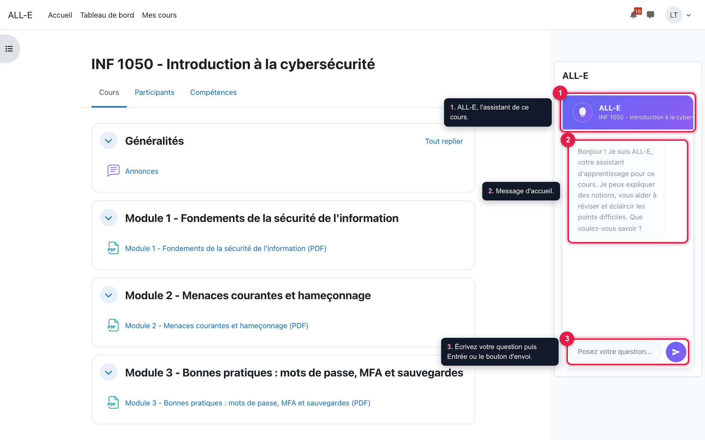

1. ALL-E se trouve dans le tiroir de droite de la page du cours. S'il est fermé, ouvrez le tiroir avec le bouton en haut à droite.
2. Il vous accueille et rappelle ce qu'il peut faire.
3. Écrivez votre question, puis appuyez sur **Entrée** ou sur le bouton d'envoi.

### 3.2 Lire la réponse

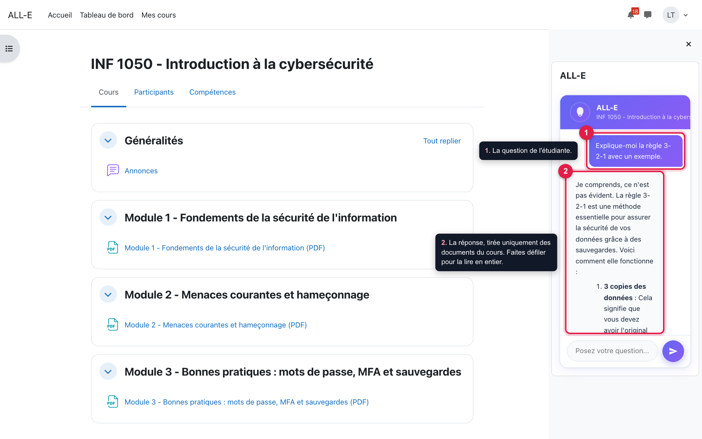

La réponse (2) s'appuie uniquement sur les documents du cours. Les longues réponses défilent dans la zone de conversation. Quand ALL-E utilise un passage précis, il le signale par `[Source N]`.

### 3.3 Un assistant empathique

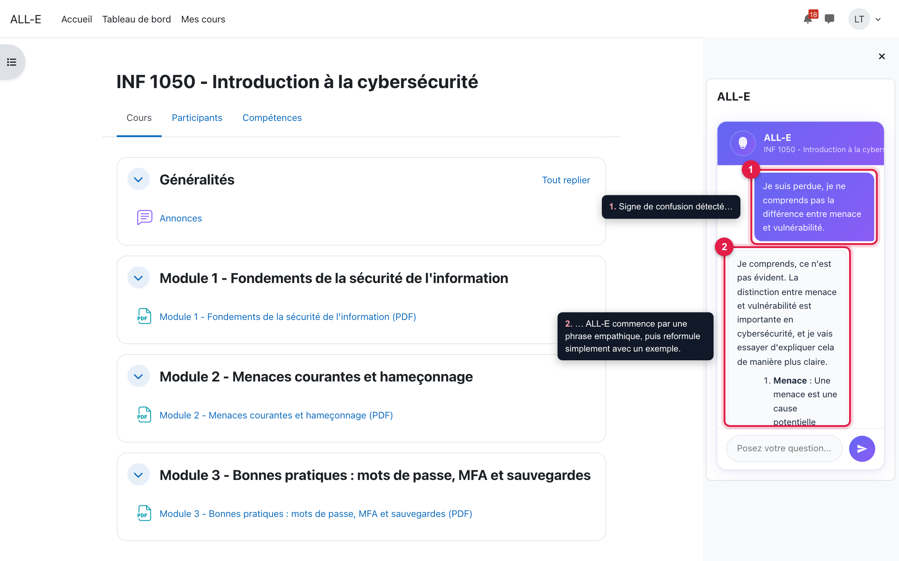

Si vous écrivez que vous êtes perdu, découragé ou stressé (1), ALL-E commence par une phrase de soutien, puis reformule plus simplement, avec un exemple (2). N'hésitez pas à dire « je ne comprends pas » : il réexplique autrement en tenant compte de vos échanges précédents.

### 3.4 Les questions hors du cours

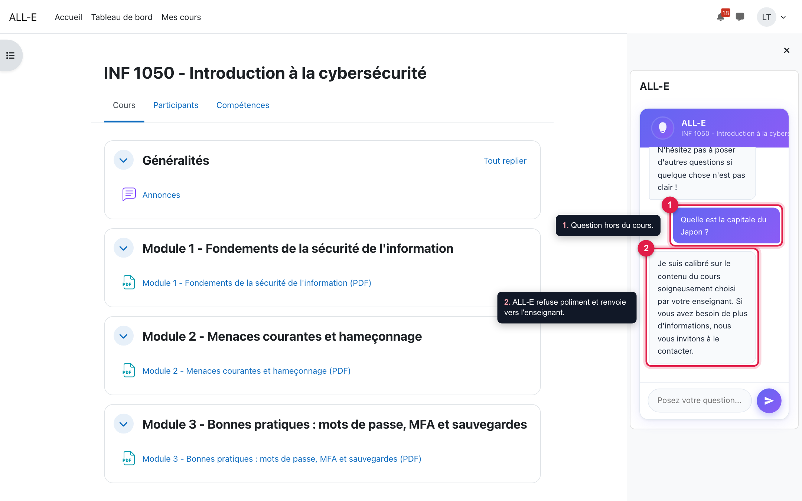

ALL-E ne répond qu'à partir du contenu choisi par votre enseignant. Pour une question hors sujet (1), il le dit poliment et vous invite à contacter votre enseignant (2).

### 3.5 Bon usage

- Posez des questions précises : « Quelle différence entre menace et vulnérabilité ? » plutôt que « Explique le module 1 ».
- Vérifiez les informations importantes dans les documents du cours : comme tout outil d'IA, ALL-E peut se tromper.
- N'écrivez pas d'informations personnelles sensibles dans vos questions.

---

## 4. Confidentialité

- ALL-E conserve, pour chaque étudiant et chaque cours, ses **dix dernières questions et réponses**, ainsi que la consigne de chaque cours.
- Les questions, l'historique récent et la consigne sont envoyés au **fournisseur d'IA** configuré (OpenRouter ou Hugging Face).
- Les documents des cours sont stockés dans **Weaviate** ; aucune donnée d'étudiant n'y est envoyée.
- Les PDF que `pdftotext` ne peut pas lire sont envoyés à Adobe PDF Services, si ce service est configuré.
- Le plugin implémente l'API de confidentialité de Moodle : export et suppression des données à la demande.

Pour garder toutes les données sur vos serveurs, utilisez le fournisseur Hugging Face pointé vers votre propre serveur d'inférence et un Weaviate auto-hébergé.

---

## 5. Dépannage

| Symptôme | Cause probable | Solution |
| --- | --- | --- |
| « Aucun document du cours n'a encore été indexé » | Aucun document téléversé, ou collection Weaviate effacée | L'enseignant téléverse les documents |
| « ALL-E n'est pas entièrement configuré : … est manquant » | Réglage obligatoire vide | Compléter les réglages (section 1.3) |
| « weaviate est injoignable » ou « L'URL est bloquée » | Weaviate arrêté, mauvaise URL, ou protection cURL de Moodle | Vérifier l'URL ; voir l'encadré de la section 1.2 |
| « … a répondu avec l'erreur HTTP 401 » | Clé API invalide | Corriger la clé OpenRouter, Hugging Face ou Weaviate |
| « Aucun texte n'a pu être lu dans ce PDF » | PDF numérisé (image) | Fournir un PDF texte, ou configurer Adobe PDF Services |
| Réponses hors sujet ou trop générales | Documents peu pertinents, seuil mal réglé | Revoir les documents ; baisser le seuil de pertinence |
| Plus de réponses après un changement de modèle de plongements | Vecteurs incompatibles | Téléverser de nouveau les documents dans chaque cours |

---

## Annexe : environnement de démonstration

Un environnement Docker prêt à l'emploi (Moodle 4.5, ALL-E, Weaviate, cours fictif déjà indexé) se trouve dans le dossier `moodle-alle-demo`, à côté du dépôt du plugin. Il se lance avec `./demo.sh start` ; voir son `README.md` et son fichier `ACCES-DEMO.txt`.
